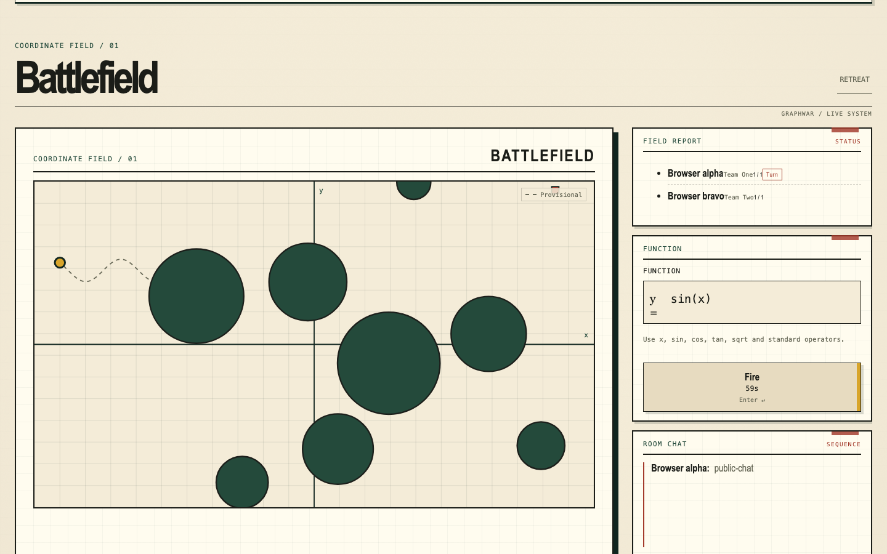

# Graphwar

Graphwar is a browser artillery game where mathematical expressions become shots on a Cartesian battlefield. Draw the line, avoid terrain and teammates, hit the opposing team.

**Play:** [graphwar.tiendepchai.id.vn](https://graphwar.tiendepchai.id.vn)



## Features

- Function, first-order ODE, and second-order ODE firing modes.
- Server-authoritative turns, collisions, deaths, terrain, and match results.
- Account registration, login, logout, session recovery, and reconnect state sync.
- Public rooms, private invite-only rooms, automatic team assignment, soldier setup, and bot slots.
- Room and in-match chat.
- Responsive, keyboard-friendly browser UI with accessible canvas descriptions.
- PostgreSQL-backed room and active-match snapshots for restart recovery.

## How to play

1. Register or sign in.
2. Create or join a public room, or join a private room with its invite code.
3. Review your assigned team, choose a soldier count and game mode, then add a bot if needed.
4. Mark yourself ready. Start when every player is ready.
5. On your turn, enter an expression, preview the path, then fire. In second-order mode, use the angle controls before firing.
6. Eliminate the opposing team.

The battlefield uses logical coordinates of `x = -25..25` and `y = -15..15`. Soldiers start on the negative-x side; Team Two sees the mirrored firing direction.

## Game modes

### Function

Enter `y = f(x)`. Graphwar translates the curve so it passes through the current soldier. Constants therefore do not change the resulting path: `2*x + 3`, `2*x - 8`, and `2*x` are equivalent shots.

### First-order differential equation

Enter `y' = f(x, y)`. The soldier position supplies the initial condition; the fired curve is the numerical solution.

Examples:

```text
y' = 3*sin(x)+2
y' = -y/3
y' = 1/(x+y)
```

### Second-order differential equation

Enter `y'' = f(x, y, y')`. The soldier position and firing angle provide the two initial conditions. Angle affects the path only in this mode.

Examples:

```text
y'' = -y + y' + 2*x - 1
y'' = 4*sin(x) + 2^x
y'' = 1.04^(-(x+y)^2)
```

## Expression syntax

Variables:

```text
x  y  y'
```

Operators:

```text
+  -  *  /  ^
```

Functions:

```text
sqrt()  log()  ln()  abs()  sin()  cos()  tan()  exp()
```

Examples:

```text
y = ((x-3)^2)/20
y = ln(abs(x))
y = sin(x/20)*5
y' = 1.2^x
y'' = (1.2^(-(x+3)^2))*(20*(-y))
```

Use parentheses to make precedence explicit. For example, write `1/(x+2)` instead of relying on `1/x+2`. Avoid curves that leave the battlefield quickly, become undefined, or exceed the allowed path length: `sqrt(abs(x))` is safer than `sqrt(x)` for soldiers on negative x.

The accepted parser rejects unknown text, unbalanced brackets, excessive expression size/depth, and non-finite results. See [`spec/parity.md`](spec/parity.md) for the compatibility checklist and deliberate browser-release differences.

## Architecture

Graphwar is a Rust workspace:

- `crates/client-wasm` — Rust/WASM browser client and canvas renderer.
- `crates/game-core` — game state, geometry, turns, collisions, and simulation.
- `crates/protocol` — versioned JSON client/server messages.
- `crates/server` — Axum HTTP/WebSocket server, authentication, rooms, bots, and snapshots.
- `migrations` — PostgreSQL schema and migrations.
- `assets/web` — static HTML/CSS and generated WASM bindings.
- `scripts/e2e.mjs` — HTTP, WebSocket, browser, accessibility, responsive-layout, and gameplay checks.
- `deploy` — Docker image and production Compose configuration.

The browser client communicates over authenticated WebSockets. The server remains the authority for every state-changing gameplay result. Rust/WASM is the sole supported implementation; [`docs/legacy-java.md`](docs/legacy-java.md) preserves a concise summary of the removed Java version.

## Development

Requirements: Rust 1.89+, the `wasm32-unknown-unknown` target, Docker for image checks, and Node.js 22+ for browser E2E.

Install the WASM target once:

```sh
rustup target add wasm32-unknown-unknown
```

Run the repository checks:

```sh
cargo fmt --all --check
cargo clippy --workspace --all-targets --locked -- -D warnings
cargo test --workspace --locked
cargo check --locked -p graphwar-client-wasm --target wasm32-unknown-unknown
cargo +1.89.0 check --workspace --all-targets --locked
cargo +1.89.0 check --locked -p graphwar-client-wasm --target wasm32-unknown-unknown
```

Build and check the release image locally (Docker daemon and Chrome required):

```sh
docker build -t graphwar:ci -f deploy/Dockerfile .
node scripts/e2e.mjs --self-check
node scripts/e2e.mjs --local-image graphwar:ci
```

The local-image gate creates its own PostgreSQL, network and app containers, binds the app to loopback, then runs the existing browser suite, restart and dump/restore checks. It removes only resources created by that run. It neither uses the production Compose stack nor deploys/pushes the image. Set `CHROME_BIN` if Chrome is not discoverable.

The real PostgreSQL Rust test is separate from ordinary unit tests. Set `GRAPHWAR_TEST_DATABASE_URL` explicitly to a loopback (`127.0.0.1`, `localhost` or `::1`) administrator connection on a **disposable test PostgreSQL server**, then run:

```sh
cargo test --locked -p graphwar-server --lib room_store::tests::postgres_round_trip_and_restart -- --ignored --exact
```

This gate creates, migrates and drops its own randomly named database; it never falls back to `DATABASE_URL`. Missing configuration or migration failures fail the gate. CI runs this test explicitly, plus Rust 1.89.0 native/WASM checks and the local-image gate. An ignored test in the ordinary workspace result is not evidence of PostgreSQL coverage.

The server requires PostgreSQL, `DATABASE_URL`, and `ALLOWED_ORIGINS`. For local development, use a disposable PostgreSQL instance and set `BIND_ADDR=127.0.0.1:8080`, `SECURE_COOKIES=false`, `GRAPHWAR_STATIC_DIR=assets/web`, plus the matching origin. Start the server with:

```sh
cargo run -p graphwar-server
```

Run browser delivery checks against a running server:

```sh
node scripts/e2e.mjs http://127.0.0.1:8080
```

## Docker Compose deployment

The production stack uses `deploy/compose.yaml` for Graphwar, PostgreSQL, and `cloudflared`. The app shares the Cloudflare Tunnel network namespace; the tunnel routes its public hostname to `http://127.0.0.1:18081`. PostgreSQL has no host port and remains on the internal database network.

1. Copy `.env.example` to `.env`.
2. Set a strong `POSTGRES_PASSWORD`, the public `DOMAIN`, and `CLOUDFLARE_TUNNEL_TOKEN_FILE`.
3. Store the Cloudflare tunnel token in the configured file. Keep that file outside Git; it is ignored by `.gitignore`.
4. Configure the Cloudflare Public Hostname to route the domain to `http://127.0.0.1:18081`.
5. Start and inspect the stack:

```sh
cp .env.example .env
# Edit .env, then place the tunnel credential in the configured token file.
docker compose --env-file .env -f deploy/compose.yaml up -d --build --wait
docker compose --env-file .env -f deploy/compose.yaml ps
docker compose --env-file .env -f deploy/compose.yaml exec app wget -qO- http://127.0.0.1:18081/healthz
```

Never paste tunnel tokens, database passwords, or `.env` contents into commits, chat, or logs. Changing `POSTGRES_PASSWORD` does not rotate an existing PostgreSQL role in an existing volume; perform credential rotation as a controlled database operation.

## Armbian CI/CD with an existing Cloudflare Tunnel

For the confirmed `home` host (`tien`, ARM64), use `deploy/compose.home.yaml`, **not** the bundled-tunnel Compose above. It publishes only `127.0.0.1:18081`, keeps PostgreSQL private and leaves the existing systemd `cloudflared` and `esphome` untouched.

The public repository never runs a self-hosted Actions runner on this machine. CI builds ARM64 on a GitHub-hosted runner, tests the same saved image with Chrome/QEMU, then the `production` environment requires owner approval before publishing `ghcr.io/tiendepchai/graphwar:run-ID-ATTEMPT`. Only trusted `master` push/manual runs publish. No image rebuild occurs after tests. All actions are pinned to commits.

Bootstrap once from the reviewed deployment files on `home`:

```sh
# Run as tien on home; hostname must already be assigned to this app.
sh deploy/install-home.sh graphwar.tiendepchai.id.vn
```

The installer refuses an existing `/home/tien/graphwar`, creates its DB password privately in `compose.env` (0600), installs a **disabled** systemd timer and performs no app/DB start. It neither installs a runner nor needs a GitHub token. No tunnel config or DNS changes are made.

Before enabling, make the GHCR package public and verify anonymous pull of the approved image. Confirm the Cloudflare hostname points to `http://127.0.0.1:18081`; never repoint a hostname currently serving another deployment without a separate cutover decision. After a successful approved release:

```sh
python3 -I /home/tien/graphwar/update-home.py --directory /home/tien/graphwar --check
# Explicit enable; subsequent approved releases deploy automatically about every five minutes.
touch /home/tien/graphwar/automatic.enabled
sudo systemctl enable --now graphwar-update.timer
sudo systemctl start graphwar-update.service
systemctl status graphwar-update.service --no-pager
```

The installed updater is fixed local code, not `git pull` or downloaded workflow code. It accepts only successful completed original-repository `master` push/manual runs, verifies ARM64/source/revision labels, pins the GHCR digest and serializes updates. It backs up a stopped existing app before replacement. State and previous digest are retained locally; the updater never prunes volumes, restores a DB or guesses cross-version rollback compatibility. A failed candidate is stopped for operator recovery rather than silently downgrading a migrated database. Updating the updater/Compose itself is a separate reviewed installation.

Pause automatic updates without stopping the running app:

```sh
sudo systemctl stop graphwar-update.timer
rm /home/tien/graphwar/automatic.enabled
```

Repository settings: environment `production` allows only `master` and requires the repository owner's review (self-review allowed for this single-owner project). Keep that approval gate until public-beta release gates below are proven. Publishing a package may initially create it private; this must be changed to public before enabling the token-free host updater. Do not put registry credentials, tunnel tokens or SSH keys in repository files.

## Public beta release gates

CI uses HTTP on loopback with disposable data; it does **not** prove public HTTPS/WSS or authorize deployment. Record the commit, tested image ID/digest, Rust/Node/browser versions, gate results and release owner. Do not mark unavailable tests as passed. Keep the same tested image for staging and release rather than rebuilding it afterward.

Before public release:

1. Pass native fmt/clippy/tests, Rust 1.89.0 native/WASM checks, the explicit PostgreSQL test and `--local-image` E2E (including asset, restart and restore assertions).
2. On separately approved **staging with disposable data**, verify HTTPS `/healthz`, browser startup, Secure/HttpOnly/SameSite cookies, registration/login/logout, session restore, WSS reconnect and a complete two-browser turn. Repeat mobile/keyboard checks; record browser/version in [`spec/parity.md`](spec/parity.md). Never run the account-creating E2E suite against an occupied production database.
3. Verify a backup and rehearse its restore; record the backup time and recovery point. A healthy `/healthz` or valid gzip alone does not prove recoverability.
4. Confirm the previous image is available and establish schema/snapshot compatibility on a database copy. Approve the release and rollback decision separately from code changes.

### Backup and restore rehearsal

With the deployment environment configured by the operator, reuse:

```sh
sh deploy/backup.sh backup
sh deploy/backup.sh verify /path/to/backup.sql.gz
```

`verify` checks gzip integrity only. Backups contain accounts, password hashes, session records and room data: restrict access, encrypt storage as appropriate, retain them outside source control and never upload them as CI artifacts. Treat an existing backup like production data even when testing it.

The local-image gate exercises dump/restore using synthetic accounts in a second disposable database. To test a selected backup manually, first verify it, then restore **only into a newly created empty, isolated database**, never over the deployment database. Example import into a newly created test container (not an existing server):

```sh
# BACKUP_FILE points to the operator-selected backup; do not print its contents.
set -eu
: "${BACKUP_FILE:?select a backup file}"
sh deploy/backup.sh verify "$BACKUP_FILE"
restore_container="graphwar-restore-$(date +%s)-$$"
docker run -d --name "$restore_container" --network none \
  -e POSTGRES_HOST_AUTH_METHOD=trust -e POSTGRES_USER=graphwar \
  -e POSTGRES_DB=graphwar_restore postgres:17-alpine
# No network/ports: trust authentication is confined to this disposable container.
# On failure, retain the container for inspection; remove only this named resource afterward.
ready=false
for attempt in $(seq 1 60); do
  if docker exec "$restore_container" pg_isready -U graphwar -d graphwar_restore >/dev/null 2>&1; then
    ready=true
    break
  fi
  sleep 1
done
[ "$ready" = true ]
# Materialize verified SQL so a decompression failure cannot be hidden by a pipeline.
restore_sql=$(mktemp)
chmod 600 "$restore_sql"
trap 'rm -f "$restore_sql"' 0
trap 'exit 1' HUP INT TERM
gzip -dc "$BACKUP_FILE" > "$restore_sql"
docker exec -i "$restore_container" psql -X -v ON_ERROR_STOP=1 \
  -U graphwar -d graphwar_restore < "$restore_sql"
rm -f "$restore_sql"
trap - 0 HUP INT TERM
```

An SQL import is only the first step. Start the candidate in the restore container's network namespace so it can reach PostgreSQL without exposing the copy. `CANDIDATE_IMAGE` must identify the already tested local image:

```sh
: "${CANDIDATE_IMAGE:?select the tested local image}"
restore_app="${restore_container}-app"
docker run -d --pull never --name "$restore_app" \
  --network "container:$restore_container" \
  -e DATABASE_URL=postgres://graphwar@127.0.0.1:5432/graphwar_restore \
  -e BIND_ADDR=127.0.0.1:8080 -e ALLOWED_ORIGINS=http://127.0.0.1:8080 \
  -e SECURE_COOKIES=false "$CANDIDATE_IMAGE"
# Wait for startup/migrations inside that isolated namespace; fail on early exit.
ready=false
for attempt in $(seq 1 60); do
  [ "$(docker inspect -f '{{.State.Running}}' "$restore_app")" = true ]
  if docker exec "$restore_app" wget -qO- http://127.0.0.1:8080/healthz; then
    ready=true
    break
  fi
  sleep 1
done
[ "$ready" = true ]
```

Confirm expected account/session counts and snapshot deserialization; compare rooms, roster, chat, practice setup and active match state. Startup/health alone is not a data comparison. This isolated manual procedure has no browser port: synthetic-session reconnect and browser assertions run in the separate `--local-image` drill. Only mark the full restore gate passed after both data and reconnect assertions, not merely `psql` exit 0. Keep any restored production copy isolated; do not contact real users or expose its sessions. Remove the candidate first with `docker rm -f "$restore_app"`, then the named test container and its owned anonymous volume with `docker rm -fv "$restore_container"` when inspection is complete. Never use global prune or delete the production volume.

### Rollback boundary

The room registry is a singleton snapshot: **one writer only**. Stop the old app before starting another version. Test an older image against a copy of the current schema/snapshot before declaring a binary rollback safe; successful Docker startup alone is insufficient. Do not run old and new writers concurrently.

If the old image cannot read current data, do not force a downgrade. Stop writes and use the rehearsed restore procedure only after the release owner explicitly accepts potential loss of changes since the backup. Never automatically restore a backup over live data, reverse migrations or discard a database volume. A failed gate means no public release, not permission to bypass it.

## License

GPL-3.0-or-later
